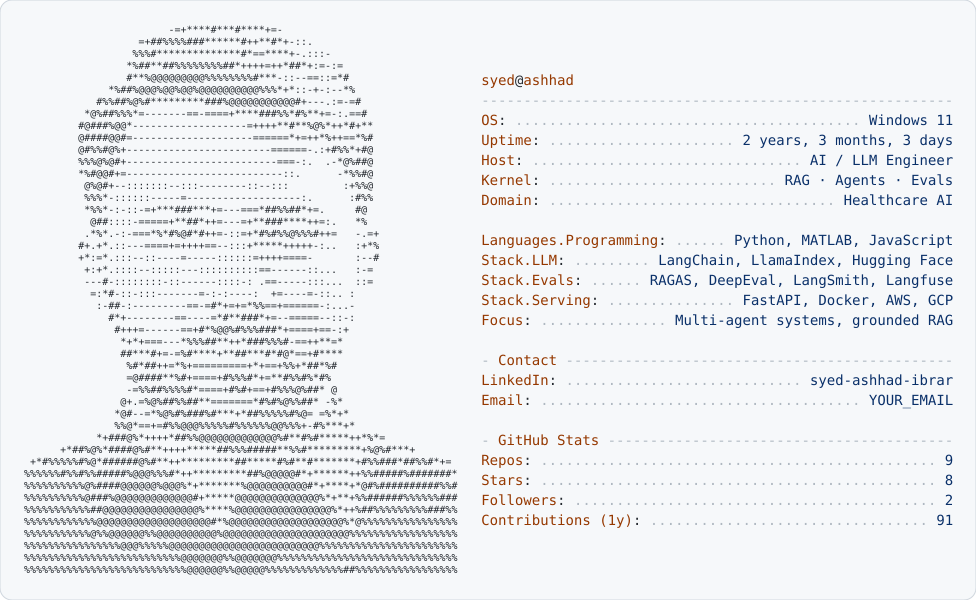

<picture>
  <source media="(prefers-color-scheme: dark)" srcset="dark_mode.svg" />
  
</picture>

**AI/ML &amp; LLM Engineer: building ML and LLM systems that are measured, not guessed.**

---

## 👨‍💻 About Me

I'm an **AI/ML & LLM engineer** building **classical ML models, RAG pipelines, multi-agent systems and the eval harnesses that keep them honest.** My approach was shaped by work in **healthcare AI**, where a confident wrong answer is a real risk and evaluation isn't optional.

- **ML:** supervised modelling, gradient-boosted ensembles, feature engineering, model selection
- **LLMs:** retrieval-augmented generation, tool-using agents, LLM-backed APIs
- **Measure:** cross-validation, golden datasets, RAG metrics, regression tests, tracing
- **Currently:** multi-agent systems, grounded RAG, and LLM fine-tuning & evaluation
- **Open to:** remote AI/ML & LLM Engineering roles and open-source collaborations

---

## 🛠️ Tech Stack

**Core & Serving**

**Machine Learning**

**LLM & RAG**

**Evaluation & Observability**

---

## 🚀 Featured Projects

| Project | What it does | Stack |
|---|---|---|
| [**PostCareAI**](https://github.com/SyedAshhadIbrar/PostCareAI) | Multimodal multi-agent system for clinician-supervised post-operative patient follow-up | Agents · Multimodal LLMs |
| [**ActLens**](https://github.com/SyedAshhadIbrar/ActLens) | Citation-backed EU AI Act compliance assistant | LangChain · Hybrid RAG |
| [**clinicdoc**](https://github.com/SyedAshhadIbrar/clinicdoc) | Audits clinical NLP datasets before training: offline, deterministic, no cloud model | Python · Data quality |
| [**Surgical Tool Navigation**](https://github.com/SyedAshhadIbrar/Aruco-Marker-Based-Surgical-Tool-Navigation-System) | Real-time ArUco marker tracking with AR guidance (direction + distance) | OpenCV · Computer vision |

---

## 📐 Engineering Principles

1. **Eval first.** No prompt, retriever or model change ships without a metric that moved.
2. **Ground every answer.** If it can't cite its source, it doesn't get said.
3. **Reproducible by default.** Pinned data, versioned prompts, deterministic test sets.
4. **Humans stay in the loop.** Where mistakes are costly, the system assists; experts decide.
